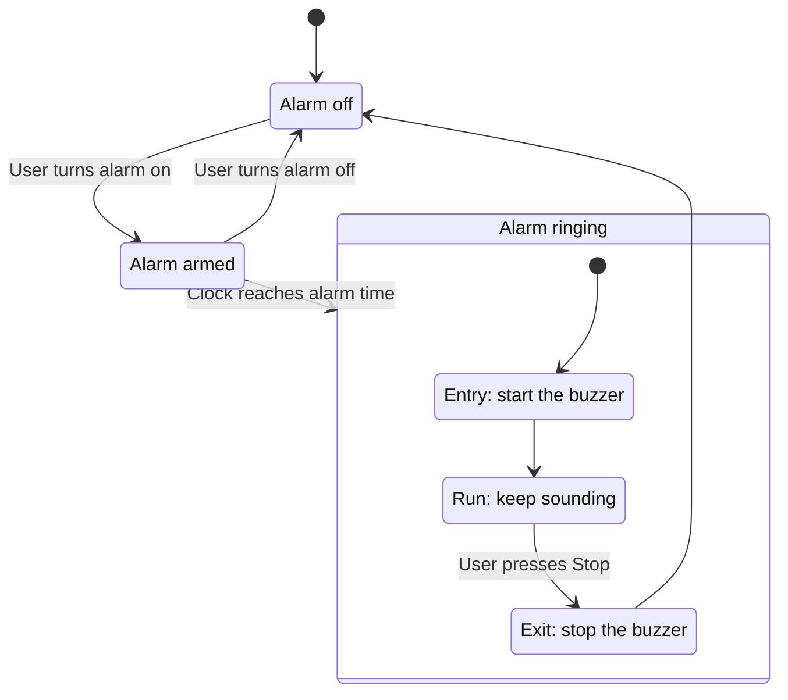

# Event-Driven State Machine

## Introduction

- Nested conditional logic main loops are hard to read and maintain.

- State machines are a common way to implement complex logic.

- States have transitions that are triggered by **events** or conditions.

  - States can have entry / exit routines that are executed when the state is entered / exited.

  - The "run" status of a state is commonly referred to as the "state machine tick" and recurrently loops.

- State diagrams are used to visualize state machines. 

- State structures are used to capture variables associated with describing the state.

## State Diagram

- Generating the state diagram is the first step in implementing a state machine.

- Usually start with "pencil and paper" to sketch out the states and transitions.

- Consider the following:

  - What are the states?

  - What are the transitions?

  - What are the events that trigger transitions?

  - What are the entry / exit routines for each state?

- UML (Universal Modeling Language) is a common way to represent state diagrams.

### State Diagram Example: A Simple Alarm Clock

A **state diagram** shows the different modes a system can be in and what
causes it to move from one mode to another. This alarm clock has three states.
It can only be in one state at a time.

For this example, assume the current time and alarm time are already set.
The clock keeps displaying the time in every state. We leave out setting the
time and using snooze to keep the first diagram simple.

## How to read the diagram

- Each **box** is a state: what the alarm clock is doing right now.
- Each **arrow** is a transition: a change from one state to another.
- The **text on an arrow** tells you what causes the change.
- The **filled circle** marks the starting point. Here, the alarm starts off.

Inside **Alarm ringing**, the entry substate starts the buzzer, the run substate
keeps it sounding, and the exit substate stops it before returning to **Alarm off**.
The entry and exit actions happen once per visit to **Alarm ringing**.

| State | What happens while the clock is in this state? |
| --- | --- |
| Alarm off | The alarm is disabled and makes no sound. |
| Alarm armed | The alarm is enabled and waits for the alarm time. |
| Alarm ringing | The alarm sounds until the user presses Stop. |

In this simplified clock, pressing Stop also disables the alarm. The user must
turn it on again for another alarm. If no event shown on an outgoing arrow
occurs, the clock stays in its current state. For example, reaching the alarm
time while the alarm is off does not make it ring.

## Follow one example

1. The clock starts in **Alarm off**.
2. The user turns the alarm on. Follow the arrow to **Alarm armed**.
3. The clock reaches the alarm time. Follow the arrow to **Alarm ringing**.
4. The user presses Stop. Follow the arrow back to **Alarm off**.

## How to build your own state diagram

1. **List the states.** Ask, "What modes can the system stay in?" For this
   clock: off, armed, and ringing.
2. **Choose the starting state.** Draw a starting marker pointing to it.
3. **Connect the states.** Add an arrow wherever a change can happen.
4. **Label each arrow.** Say what event causes that change.
5. **Walk through an example.** Check that you can follow the arrows from
   beginning to end.

Keep states and events separate: **Alarm ringing** is a state the clock stays
in; **User presses Stop** is an event that makes it leave that state.
