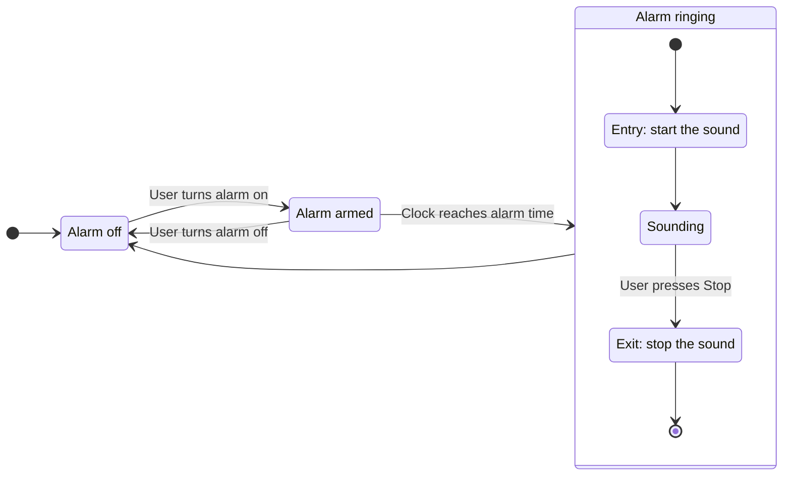

# Event-Driven State Machine

## Introduction

- Nested conditional logic main loops are hard to read and maintain.

- State machines are a common way to implement complex logic.

- States have transitions that are triggered by **events** or conditions.

  - States can have entry / exit routines that are executed when the state is entered / exited.

  - The "run" status of a state is commonly referred to as the "state machine tick" and recurrently loops.

- State diagrams are used to visualize state machines. 

- State structures are used to capture variables associated with describing the state.

## State Diagram

- Generating the state diagram is the first step in implementing a state machine.

- Usually start with "pencil and paper" to sketch out the states and transitions.

- Consider the following:

  - What are the states?

  - What are the transitions?

  - What are the events that trigger transitions?

  - What are the entry / exit routines for each state?

- UML (Universal Modeling Language) is a common way to represent state diagrams.

### State Diagram Example: A Simple Alarm Clock

# State Diagram: A Simple Alarm Clock

A **state diagram** shows the different modes a system can be in and what
causes it to move from one mode to another. This alarm clock has three
top-level states. Only one top-level state is active at a time. The Ringing
state also contains substates that show the steps within that mode.

For this example, assume the current time and alarm time are already set.
The clock keeps displaying the time in every state. We leave out setting the
time and using snooze to keep the diagram simple.

## How to read the diagram

- Each **box** is a state: what the alarm clock is doing right now. Boxes
  inside **Alarm ringing** are substates. While one of those substates is
  active, the enclosing Ringing state is also active.
- Each **arrow** is a transition: a change from one state to another.
- The **text on an arrow** tells you what event causes the change. Unlabeled
  arrows advance automatically when the preceding step finishes.
- A **filled circle** marks a starting point. The outer one starts the clock
  in **Alarm off**; the inner one starts Ringing in its **Entry** substate.
- The **circle with a ring around it** marks completion of the Ringing
  sequence. It leads to the automatic transition from **Alarm ringing** to
  **Alarm off**; it does not stop the clock itself.

| State | What happens while the clock is in this state? |
| --- | --- |
| Alarm off | The alarm is disabled and makes no sound. |
| Alarm armed | The alarm is enabled and waits for the alarm time. |
| Alarm ringing | The clock runs the Entry, Sounding, and Exit substates in order. |

| Substate inside Alarm ringing | What happens in this step? |
| --- | --- |
| Entry: start the sound | The clock starts the alarm sound, then automatically moves to Sounding. |
| Sounding | The alarm keeps sounding until the user presses Stop. |
| Exit: stop the sound | The clock silences the alarm, then completes Ringing and automatically moves to Alarm off. |

Entry and Exit are brief setup and cleanup substates in this example;
Sounding is the substate that waits for a user event. These substates make
the steps explicit. In other state diagrams, the same setup and cleanup
may be written as entry and exit actions on Ringing instead of separate
substates.

In this simplified clock, pressing Stop also disables the alarm. The user must
turn it on again for another alarm. In a state that waits for an event
(Alarm off, Alarm armed, or Sounding), the clock stays there until an event
shown on an outgoing arrow occurs. For example, reaching the alarm time
while the alarm is off does not make it ring. Entry and Exit advance
automatically when their work is done.

## Follow one example

1. The clock starts in **Alarm off**.
2. The user turns the alarm on. Follow the arrow to **Alarm armed**.
3. The clock reaches the alarm time. Follow the arrow to **Alarm ringing**,
   then its inner starting marker to **Entry: start the sound**.
4. The clock starts the sound and automatically moves to **Sounding**.
5. The user presses Stop. Follow the arrow to **Exit: stop the sound**.
6. The clock silences the alarm and reaches the inner completion marker.
   Ringing is complete, so follow the automatic arrow back to **Alarm off**.

## How to build your own state diagram

1. **List the states.** Ask, "What modes can the system stay in?" For this
   clock: off, armed, and ringing. If a mode has internal steps, draw those
   substates inside it: Ringing contains Entry, Sounding, and Exit.
2. **Choose the starting states.** Draw the outer starting marker pointing
   to Alarm off and an inner starting marker pointing to Ringing's Entry.
3. **Connect the states.** Add an arrow wherever a change can happen.
   Connect Exit to an inner completion marker, then connect Ringing to Off
   so completing the internal sequence returns the clock to Alarm off.
4. **Label event-driven arrows.** Say what event causes each change, such
   as pressing Stop. Leave automatic transitions unlabeled and explain
   when they occur.
5. **Walk through an example.** Check that you can follow the outer and
   inner arrows, including setup and cleanup, from
   beginning to end.

Keep states and events separate: **Alarm ringing** is the enclosing state,
and **Sounding** is the substate that waits. **User presses Stop** is an event
that moves the clock from Sounding to Exit; after cleanup, the clock leaves
Ringing and returns to Alarm off.
